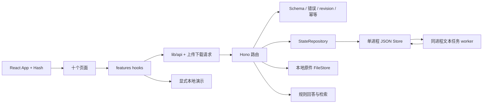
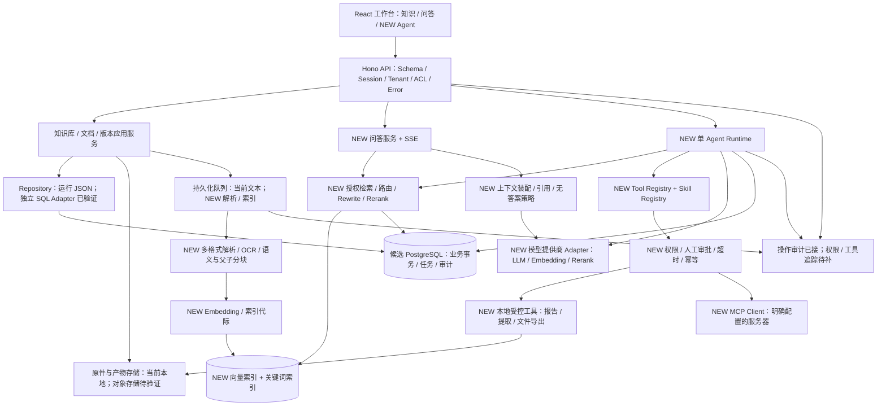

# Zhixu Knowledge Hub：全项目源码基线与阶段优化方案

审查补充日期：2026-11-06。目标仓库：`LazyYang-v/zhixu-knowledge-hub`。

归档说明：本文 Git 状态与“未提交工作区”描述记录审查时点。本次 P1/P2 代码交付包含这些后续改动，原快照标签保持不变；最新实现与验证状态以 `phase-2-progress.md` 和 `local-auth-access.md` 为准。

本文补齐最初要求的八项系统交付物。先前 `phase-1-review.md` 主要描述前端，且部分描述与目标快照不一致；这里以 `git show snapshot-2026-11-06:<path>` 的实际内容为准。本文形成于 P1/P2 增量工作之后，不把这些后续改动描述成快照原有能力。初次补充只新增审查/设计文档；后续 P2 修复更新在“当前”状态列，未执行数据库迁移或部署。

## 1. 源码审查报告

### 1.1 Git 与证据范围

| 检查 | 实际证据 |
| --- | --- |
| 当前分支 | `main` |
| 当前 Commit | `7c8e15d744223fd29114aed7625e0c1025bc59bc` |
| 目标标签 | `snapshot-2026-11-06`，annotated tag 对象 `6c7270399217bb85a43f35e127b2d2fdf873e238` |
| 标签指向 Commit | `snapshot-2026-11-06^{commit}` 与当前 HEAD 相同 |
| 工作区 | 本补充开始时 52 条已跟踪修改、46 条未跟踪状态条目；未跟踪条目含目录，不能当作文件数。包括 P1/P2 增量及用户备份，均保留 |
| 快照文件数 | `git ls-tree -r --name-only snapshot-2026-11-06`：88 个跟踪文件 |
| 快照检查方式 | `git show`、`git ls-tree`、`git cat-file`；未 checkout、reset、stash 或覆盖工作区 |
| 当前验证证据 | 最新 SQL 基础 8 项独立 PostgreSQL 测试、64 项原有测试、类型检查和构建通过；13 项 E2E 为前轮结果，本次未重跑；范围见 `phase-2-progress.md`，不是快照测试结果 |
| 未触碰 | 用户 `zhixu-offline-server.mjs.bak` 未读取或修改；未读取生产数据库或部署凭据 |

关键证据：快照 `server/index.ts` 导入 `./data/seed.js`，但 `git cat-file -e snapshot-2026-11-06:server/data/seed.ts` 退出 128；树中无该源码。快照 `.gitignore` 的 `data` 会忽略同名目录。当前 P1 已改成 `/data/` 并提供 `server/data/seed.ts`，但它尚未提交，不能声称远端快照已修复。

### 1.2 真实目录树

以下是目标快照全部跟踪文件，按实际树生成；没有把当前新增目录混入快照。

```text
knowledge/
├── .gitignore
├── README.md
├── artifacts/
│   ├── desktop-final.png
│   ├── desktop-initial.png
│   ├── desktop-reference.png
│   ├── desktop.png
│   ├── evaluation.png
│   ├── mobile-chat.png
│   └── mobile-docs.png
├── docs/v2/phase-1-review.md
├── index.html
├── package-lock.json
├── package.json
├── public/favicon.svg
├── server/
│   ├── app.ts
│   ├── index.ts
│   ├── lib/
│   │   ├── store.ts
│   │   └── util.ts
│   ├── routes/
│   │   ├── conversations.ts
│   │   ├── governance.ts
│   │   └── knowledge.ts
│   ├── services/
│   │   ├── answer.ts
│   │   └── search.ts
│   ├── tsconfig.json
│   └── types.ts
├── src/
│   ├── App.tsx
│   ├── components/
│   │   ├── Markdown.tsx
│   │   ├── ui.tsx
│   │   └── ui/
│   │       ├── Button.tsx
│   │       ├── ConfirmDialog.tsx
│   │       ├── DataTable.tsx
│   │       ├── Drawer.tsx
│   │       ├── EmptyState.tsx
│   │       ├── ErrorState.tsx
│   │       ├── Field.tsx
│   │       ├── Input.tsx
│   │       ├── Pagination.tsx
│   │       ├── Select.tsx
│   │       ├── Skeleton.tsx
│   │       ├── Tabs.tsx
│   │       ├── Toggle.tsx
│   │       ├── index.ts
│   │       └── legacy-core.tsx
│   ├── features/
│   │   ├── audit/
│   │   │   ├── data.ts
│   │   │   ├── types.ts
│   │   │   └── useAudit.ts
│   │   ├── chat/
│   │   │   ├── composer.ts
│   │   │   ├── useConversations.ts
│   │   │   └── useFeedback.ts
│   │   ├── evaluation/
│   │   │   ├── data.ts
│   │   │   ├── types.ts
│   │   │   └── useEvaluation.ts
│   │   ├── knowledge/
│   │   │   ├── data.ts
│   │   │   ├── presenters.tsx
│   │   │   ├── seed.ts
│   │   │   ├── types.ts
│   │   │   ├── useDocumentState.ts
│   │   │   ├── useKnowledge.ts
│   │   │   └── useKnowledgeBases.ts
│   │   ├── permissions/
│   │   │   ├── data.ts
│   │   │   ├── types.ts
│   │   │   └── usePermissions.ts
│   │   ├── retrieval/
│   │   │   ├── searchDocs.ts
│   │   │   └── useRetrieval.ts
│   │   ├── settings/
│   │   │   ├── types.ts
│   │   │   └── useSettings.ts
│   │   └── tasks/useTasks.ts
│   ├── layouts/
│   │   ├── Sidebar.tsx
│   │   ├── Topbar.tsx
│   │   └── navigation.ts
│   ├── lib/
│   │   ├── api.ts
│   │   ├── chat-data.ts
│   │   └── storage.ts
│   ├── main.tsx
│   ├── pages/
│   │   ├── ChatPage.tsx
│   │   ├── GovernancePages.tsx
│   │   ├── KnowledgePages.tsx
│   │   ├── OverviewPage.tsx
│   │   ├── chat.css
│   │   ├── governance.css
│   │   ├── knowledge.css
│   │   └── overview.css
│   ├── styles.css
│   └── styles/
│       ├── components.css
│       └── tokens.css
├── tsconfig.json
├── vite.config.ts
└── 企业知识库智能问答仪表盘.png
```

单 package、单 lockfile，前后端同仓库不同目录；没有 workspaces、独立后端依赖包、数据库迁移目录、Docker/Compose、`.github/workflows`、测试目录或 Agent 模块。该结论只适用于跟踪快照；不推断仓库外的部署平台。

当前增量新增 `shared/`、`server/http/`、`server/jobs/`、`server/repositories/`、`src/hooks/`、`src/providers/`、拆分页面及 `tests/`；具体清单见 P1/P2 实施记录。

### 1.3 技术栈矩阵

| 层 | 快照实际实现 | 文件与判断 |
| --- | --- | --- |
| 前端 | React 19.1、TypeScript、Vite 6（package 范围），Hash 路由 | `package.json`、`vite.config.ts`、`src/App.tsx`；无 Next/Vue/React Router |
| UI | 原生 CSS、Lucide、自有 UI；已有 Token 文件与控件 | `src/styles/tokens.css`、`src/components/ui/`；没有 Ant Design、MUI 或 shadcn 依赖，优先复用 |
| 文本渲染 | react-markdown 10、remark-gfm 4、Mermaid 12 | `src/components/Markdown.tsx`；Mermaid `securityLevel: strict`；没有 rehype-raw，不能仅凭 innerHTML 就断言可利用 XSS |
| 状态/请求 | React hooks、localStorage、fetch | `src/lib/api.ts`、`src/lib/storage.ts`、`src/features/*`；快照失败返回 null，业务混入演示 |
| 后端 | Node.js + TypeScript + Hono、@hono/node-server、tsx | `server/index.ts`、`server/app.ts`、`package.json`；3 组路由，非 Spring/FastAPI |
| 业务层 | 路由直接读改 Store，另有规则检索/回答函数 | `server/routes/*.ts`、`server/services/{answer,search}.ts`；未形成完整 Service/Repository 结构 |
| 存储 | JSON 文件、内存缓存、整个文件覆盖写入 | `server/lib/store.ts`；不是 SQL，`server/types.ts` 的 interface 不是数据库迁移 |
| 模型 | 固定回答与正则意图；配置仅字符串/布尔字段 | `answer.ts:answers/identifyAnswer/sourceFor`、`governance.ts:/settings`；无模型 SDK、HTTP 模型调用或密钥读取 |
| 检索 | CJK 二元词、ASCII token、同义词及规则加权 | `search.ts:tokenize/expand/search/buildCorpus`；dense/rerank 字段不是 Embedding/Rerank 模型输出 |
| Agent/Skills/MCP | 无运行时、注册表或 MCP 客户端 | 快照树与依赖清单；开发代理使用的技能不等于产品已支持 Skills |
| 部署/测试 | npm 开发/构建命令；无跟踪自动测试与 CI/CD | `package.json`、`server/tsconfig.json`；build 仅前端配置，check 才覆盖后端 |

更正旧审查：快照 Token 文件已有 95 行、品牌/状态/间距/圆角/阴影/字体族/动效变量，不是“只有 9 个变量”。快照大页分别为 ChatPage 1328、KnowledgePages 1388、GovernancePages 1621 行；不能引用更早版本的行数充当本快照证据。

### 1.4 功能实现矩阵

“完整”仅指下表限定的操作，不表示企业安全、真实模型或全部业务闭环完整。

| 功能 | 快照分类 | 证据 | 当前增量状态 |
| --- | --- | --- | --- |
| 十页导航/Hash 深链接 | 已完整实现：静态导航范围 | `App.tsx`、`layouts/navigation.ts` | 保留，补导航草稿确认 |
| Markdown、表格、代码、Mermaid | 已完整实现：渲染范围 | `components/Markdown.tsx` | 保留；全面 XSS/浏览器组合未验收 |
| 主题 | 部分实现：浅色主体+深色侧栏，无主题管理 | `styles/tokens.css`、`Topbar.tsx` | `ThemeProvider.tsx` 支持 light/dark/system；十页 E2E |
| 工作台统计 | 部分实现：有 API，页面含静态概览 | `OverviewPage.tsx`、`governance.ts:/overview` | 当前接真实保存记录；趋势/系统容量不是实测 |
| 知识库 CRUD | 部分实现：API 可持久化，无关系/ACL 保证 | `knowledge.ts:/bases` | 稳定 baseId 兼容、改名关系同步、非空删除保护、revision |
| 搜索/筛选/排序 | 部分实现：前端与 API 基础过滤 | `KnowledgePages.tsx`、`knowledge.ts:/documents` | 当前卡片/表格/排序；服务端分页尚无统一实现 |
| 文件/网页导入 | 仅有元数据登记，不是实际上传/抓取 | `knowledge.ts:/documents/import` | 当前原件上传/下载已实现；网页仍只登记 URL |
| 文本切分 | 部分实现：同步 200 字符切分，标为语义分块 | `knowledge.ts:splitText` | 当前持久化 worker，Unicode 固定长度；无语义/父子分块 |
| 任务阶段/重试 | Mock 或占位执行 | `useDocumentState.ts` 900ms timer；`knowledge.ts:/advance` | 当前真实文本任务、事件、取消、租约恢复；手动 advance 禁用 |
| 分块/历史/回滚 | 部分实现：数组快照，无并发控制 | `knowledge.ts:nextVersion` 与 chunks/rollback 路由 | 当前原子批量编辑、历史复制、精确边界、版本冲突保护 |
| 文档版本与真实索引一致性 | 尚未实现：不存在索引 | `server/types.ts`、`search.ts` | 当前仅文本版本；原子发布索引代际待 P3 |
| 会话/消息/反馈 | 部分实现：可保存；清空/取消反馈/多轮存在契约问题 | `conversations.ts`、`useConversations.ts`、`useFeedback.ts` | 当前清空/反馈闭环、多轮开关、部分删除恢复已有测试 |
| 模型问答、SSE、再生成 | 尚未实现：回答为预置规则 | `answer.ts`、`conversations.ts` | 仍无模型/SSE；再生成需新服务端协议 |
| 引用来源 | Mock 或占位溯源 | `answer.ts:sourceFor` 固定 id/version/page | 当前界面已说明边界，真实 chunk→原文定位未实现 |
| 向量/混合/Rerank | Mock 或占位模型效果 | `search.ts` 规则分数 | 仍无真实向量索引；不是可上线 RAG |
| 多知识库路由/权限过滤 | 尚未完整实现 | `search.ts` 仅按 scope 名称筛选 | 当前显式 baseIds 返回 BASE_ROUTING_UNAVAILABLE；scope 不是权限过滤 |
| 权限配置 | 仅有配置持久化与界面 | `governance.ts:/permissions` | 当前 revision/最后管理员/邮箱去重；不是认证或授权 |
| 质量评测 | Mock 或占位评测口径 | `governance.ts:sampleQuestions` 与 evaluations handler | 仍未按 expected 来源/真实答案判定；随机阶段耗时不作性能指标 |
| 审计查询 | 部分实现，证据链含伪造通过 | `governance.ts:/audit/:id` | 当前提交审计/失败写事件、消息关联与主体标记已补；可信身份、GET 授权与工具审计仍未齐全 |
| 模型配置 | 仅有配置表单/字段 | `Settings`、`GovernancePages.tsx:SettingsPage` | 当前参数校验与实际文本参数生效；提供商连通性/密钥无实现 |
| 单 Agent 执行、Skills、Tools、MCP | 尚未实现 | 无对应产品源码 | 仅目标设计，不把 RAG 或开发代理当作运行时 |
| 运行环境、外部 SSO/模型订阅、真实数据规模 | 无法确认 | 仓库不能证明外部状态 | 需要选型/实际环境验证，不推断已存在 |

### 1.5 当前模块依赖与业务生命周期



快照导入→切分→发布→检索不经过真实解析器、Embedding 或索引；前端 timer 可以把元数据任务推进到 done。当前文本导入才有真实持久化执行；其他格式保存原件后报告处理器未接入。当前所有资源读取/修改仍缺可信身份和后端 ACL，revision 与幂等不是权限控制。

## 2. 问题清单

优先级指目标实施阶段；“当前”说明修复落在未提交工作区还是仍待实现。Critical 表示数据/权限核心风险，不表示已经证实生产漏洞被利用。

| ID | 模块 | 问题 | 证据文件/符号 | 严重程度 | 优先级 | 修复建议与当前状态 |
| --- | --- | --- | --- | --- | --- | --- |
| F01 | 源码完整性 | 快照缺少被入口引用的 seed | `server/index.ts`、快照树、`.gitignore` | High | P0/P1 | 修正忽略规则并纳入源码；当前文件已补，尚未提交 |
| F02 | 存储 | 读文件/JSON 异常被当作首次运行，可能用 seed 覆盖数据 | `server/lib/store.ts:load` | Critical | P1/P2 | 当前只对 ENOENT 初始化；已有 JSON 不再合并 seed；缺必需根字段/配置数组拒绝加载及写入，空集合/未知字段保留；已有隔离回归 |
| F03 | 存储 | 共享 tmp、并发写/失败 mutation 暴露未落盘内存 | `store.ts:update/flush` | High | P1/P2 | 单进程串行原子副本；当前已修，多实例仍不支持 |
| F04 | 认证/授权 | 全资源无真实登录/租户/成员校验 | `server/app.ts`、三组路由 | Critical | P2 | 身份方案确认后统一后端授权，含列表、引用、文件与任务事件；未完成 |
| F05 | 前端请求 | 非 2xx/网络错误统一 null，乐观 UI 可伪成功 | 快照 `src/lib/api.ts`、各 feature hooks | High | P1 | 错误分类与显式演示；当前已修并有拒绝/超时测试 |
| F06 | 文档任务 | 浏览器 timer 与 advance 制造处理成功 | `useDocumentState.ts`、`knowledge.ts:/advance` | High | P2 | 持久化 worker/状态机；当前仅文本闭环，不冒充解析/索引 |
| F07 | 上传 | file 模式从未传输字节 | 快照 `KnowledgePages.tsx:UploadModal`、import 路由 | High | P2/P3 | 当前已保存原件并校验，复杂格式解析/隔离/杀毒仍缺 |
| F08 | 版本 | 版本主号被写成 v1；数组复用污染旧版本；并发覆盖 | `knowledge.ts:nextVersion`、chunks 路由 | High | P2 | 当前复制快照、revision、批量原子保存、边界保留已修 |
| F09 | 关联 | 知识库改名/删除不维护 category 文档关系 | `knowledge.ts:/bases/:id` | High | P2 | 当前 baseId 兼容和非空保护；SQL 约束待实现 |
| F10 | RAG | dense/rerank 固定区间加分，无关项仍约 0.82；阶段耗时 Math.random | `search.ts:search` | High | P3 | 替换成实测分阶段检索；当前仅如实标识，不作为质量/延迟基线 |
| F11 | 契约 | P2 早期曾接受 baseIds 但检索与问答未消费 | `shared/contracts.ts`、`server/http/validation.ts`、两组路由 | High | P2/P3 | 当前已明确 400 拒绝，含空数组；真正多库授权路由仍待实现 |
| F12 | 评分算法 | BM25 idf 使用当前 chunk 的 token 频次充当文档频率；高频时对数参数可能不合法再被默认值兜底 | `search.ts:search` 的 idf 计算 | High | P3 | 建全语料 df 或使用确认后的 FTS；评测含重复词/无关词，不把当前数值当标准 BM25 |
| F13 | 引用 | 固定 sourceFor，与检索命中/版本/实际权限脱节 | `answer.ts:sourceFor`、`conversations.ts` | High | P3 | 从授权命中 chunk 构造引用，精确版本与位置，删除/撤权不能继续泄露 |
| F14 | 评测 | expected 未参与命中判断，accuracy 仅分数阈值 | `governance.ts:/evaluations` | High | P3 | 用标注来源/答案/无答案/权限数据集；旧记录标为旧口径 |
| F15 | 输入 | readJson 接受数组、吞 JSON 错误、未知字段；无统一尺寸 | 三组快照路由的 readJson | High | P2 | 当前严格 Zod/24MB 上限、错误码已修；非 JSON/路径/响应 Schema 仍需补齐 |
| F16 | CORS | 默认任意来源，且无身份体系 | 快照 `server/app.ts:cors()` | Medium | P2 | 当前来源白名单；以后补 cookie/CSRF 策略，CORS 不是认证 |
| F17 | 审计 | action 名不一致、按问题文本找会话、捏造权限通过 | `governance.ts:/audit/:id,/overview`、`conversations.ts`、`services/audit.ts` | High | P2 | 当前原子提交审计、失败写请求、实际消息关联与旧声明 DTO 纠正已补；真实身份/GET 访问/工具审计未完成 |
| F18 | 会话 | multiTurn 未消费，反馈取消前后端不一致 | 快照 `conversations.ts`、`useFeedback.ts` | Medium | P1/P2 | 当前 false/null 契约与清空/部分删除已回归 |
| F19 | UI 结构 | 巨型页面与混合本地/远端状态，重复视图/业务逻辑 | `ChatPage.tsx`、`KnowledgePages.tsx`、`GovernancePages.tsx` | Medium | P1 | 当前页面拆分、共享状态反馈；聊天仍需继续按服务端协议分层 |
| F20 | 数据体积 | 高 overlap 可能产生大量重复分块与全量 JSON 副本 | `jobs/worker.ts:chunkText`、`store.ts:flush` | High | P2/P3 | 当前有数量/总长度上限；SQL/增量索引后实测资源与容量 |
| F21 | 上传生命周期 | 无恶意文档隔离、无孤立原件保留期/清理策略 | 当前 `services/files.ts`、`routes/files.ts` | High | P2/P5 | 建隔离与清理 dry-run，业务留存期需确认；禁止自动删原数据 |
| F22 | 模型配置 | 名称/开关可保存，但不会建立模型连接或实际 rerank | `Settings`、`governance.ts:/settings` | Medium | P3 | 配置能力状态、连接测试、密钥引用与模型 profile；不要展示伪成功 |
| F23 | 安全验证 | Mermaid 注入 SVG、Markdown 外链尚无完整攻击回归 | `components/Markdown.tsx` | Medium | P5 | strict 与默认转义是已有措施；用危险链接/SVG/代码围栏样本验证，不无证据声称 XSS |
| F24 | 上下文安全 | 未建立检索文本/工具结果与系统指令的信任分离 | `answer.ts` 目前未调用模型；未来 runtime 文件 NEW | High | P3/P4 | 接模型前定义引用文本为非可信数据，工具权限不由模型输出决定 |
| F25 | 部署 | 无 Docker/迁移/CI；health 只证明进程响应 | 快照树、`server/app.ts:/health` | High | P5 | 构建/迁移/依赖 readiness 和临时环境冒烟；当前尚未部署验证 |
| F26 | 凭据 | 当前没有 API Key 存储实现；后续若把密钥放普通 Settings 将泄露 | `server/types.ts:Settings`、`src/pages/SettingsPage.tsx` | High | P3/P5 | 仅存 secretRef，读接口返回掩码；外部 Secret 服务需选型，不臆造现有泄露 |
| F27 | 标识符 | 快照 createId 仅 4 个随机字节，JSON 无全局唯一约束，规模增大后可能碰撞 | `server/lib/util.ts:createId` | High | P2 | 当前新 ID 改为 UUID，旧 ID 保留；`server/services/data-check.ts` 已检查核心重复 ID，数据库唯一约束与 SQL 事务核验仍待实现 |

本轮只读正确性复现：调用当前 `search(createSeedDb().documents, {query:'zzzz_unrelated_987654321', strategy:'混合检索', threshold:0.65, topK:5})`，返回 5 个得分均为 0.82 的结果。仅使用仓库 seed、没有读写用户数据。这证明无关项的规则分数下限问题，不是性能压测、真实向量评测或新修复；F10/F12 仍待处理。

## 3. 前端页面优化矩阵

真实路由来自 `layouts/navigation.ts`；快照对应两个聚合文件的导出函数，当前独立页面均已存在。Agent/模型管理专页为新增建议，不能计入现有十页。

| 路由 / 当前实现文件 | 当前问题 | 视觉优化 | 交互/组件调整 | API 依赖 | 验收条件 |
| --- | --- | --- | --- | --- | --- |
| `#overview` / `src/pages/OverviewPage.tsx` | 真实统计与示例趋势/健康需分开 | 沿用语义 Token，概览→任务→最近资产层级 | 复用 StatCard/RequestStatus；任务/文档可跳转；健康状态需独立 readiness | `/overview`、`/knowledge/tasks`、`/knowledge/documents`；NEW readiness | 统计与 API 相等；无数据/失败可恢复；不把存活检查说成模型健康 |
| `#knowledge` / `KnowledgePage.tsx` | 缺资源级成员与后端分页 | 卡片/表格一致密度、暗色对比 | 搜索/排序已有；补 cursor；创建/重名/非空删除提示 | `/knowledge/bases`；NEW grants | 改名文档仍关联；409 保留输入；撤权后 API 也不可见 |
| `#documents` / `DocumentsPage.tsx`、`UploadModal.tsx` | TXT/MD 闭环已有；其他格式待解析；版本/索引不同步 | 文件类型、处理状态、版本、引用位置分层 | 原件上传/进度/取消/重试、分块原子编辑已接；补解析页定位与版本索引状态 | files/import/chunks/rollback/tasks；NEW index generations | 断线无伪成功；重试不重复；旧 worker 不覆盖新版本；未解析不可发布 |
| `#tasks` / `TasksPage.tsx`、`features/tasks/TaskDetails.tsx` | 无真实解析/索引任务、遗留任务缺事件 | 状态/阶段/错误原因明确，长日志可阅读 | Tabs/DataTable/Drawer；JSON 事件增量轮询，未来 SSE 复用 sequence | tasks/retry/cancel/events | 关页面任务继续；进程恢复；重试/取消合法状态；看不到输入全文/租约密钥 |
| `#chat` / `ChatPage.tsx`、`features/chat/components/` | 无模型、流式、真实来源、再生成；大页仍较复杂 | 会话/内容/证据三栏，移动切换，代码/表格横向容器 | 保留真实消息/反馈闭环；补 SSE 状态机、取消、引用定位、模型选择 | conversations/messages/feedback；NEW streaming/regenerate/citations | 连续事件不重复落消息；中断可恢复；引用属于本次授权检索且定位正确 |
| `#retrieval` / `RetrievalPage.tsx` | 规则检索分数/阶段不是模型测量；baseIds 未接 | 参数区与结果/过程区统一 | 保留提交参数快照、取消旧请求；新增真实 keyword/vector/rerank 对照 | `/retrieval/search`；NEW profiles | baseIds 实际生效；无关查询能返回空；阶段时间来自测量 |
| `#evaluation` / `EvaluationPage.tsx` | 指标旧口径，缺数据集与版本化基线 | 指标明确“规则判定/真实评测” | 历史表格+样本详情；真实 eval worker 与失败重试 | evaluations；NEW datasets/run events | expected 参与判断；无答案/权限样本纳入；失败不能标已完成 |
| `#permissions` / `PermissionsPage.tsx` | 只有全局静态矩阵，成员不是账户 | 权限表格冻结语义、操作危险色 | revision 已接；补用户/角色/部门/资源 grants；最后管理员保护 | permissions/members/rules；NEW auth/grants | 两用户跨库/跨租户访问 403/404；UI 与后端授权一致 |
| `#audit` / `AuditPage.tsx` | 提交/失败写审计已有；仍无可信 actor/GET/工具事件 | 事件→资源→请求关联，日期含时区 | CSV 防公式、主体/请求/资源 ID 与字段名详情已接；补时间/actor/outcome cursor | audit/detail；NEW structured events filters | 精确关联 message/run/tool；新事件不记录密钥/全文；幂等重放不重复业务事件 |
| `#settings` / `SettingsPage.tsx` | 模型名称/开关无提供商连接 | 配置分组与可用状态；禁用项给原因 | Field/Tabs/未保存确认已有；补连接测试、模型权限与掩码密钥 | settings；NEW model configs/test | 配置验证失败保留输入；配置版本冲突不覆盖；密钥不出现在 GET/日志 |
| NEW `#agent` / `src/pages/AgentPage.tsx` | 当前不存在 | 任务/计划/步骤/审批/产物为主，不伪装聊天 | 事件流、暂停/审批、取消/重试、下载产物；复用任务视图 | NEW agent tasks/runs/approvals/artifacts | 三个端到端场景交付真实文件；审批拒绝无副作用 |
| NEW 登录入口 / `src/pages/LoginPage.tsx` | 当前不存在 | 使用现有 Field/Button/主题，保留登录前错误 | 本地登录或 SSO 跳转由选型决定；session 过期恢复原页面 | NEW auth endpoints | 过期返回登录；未认证直调 API 不获取数据 |

Design Tokens 继续扩展已有 `src/styles/tokens.css`，不换组件库。当前字号为 12/13/14/18/24px 对应 rem Token，间距沿用 8px 基础并已有 4px 补充，控件 32/36/40px、圆角 8/12/16px、动效 150/180/220ms。语义色、focus-visible、disabled、loading 与空/错状态复用现有控件。当前断点跨页为 550/600/760/800/900/1000/1100/1150/1180/1200 等，属于待收敛项；优先保留已验证的 390px 与桌面布局，再评估 760/900/1200 三个主布局档，不能未经回归全局替换媒体查询。

## 4. 目标架构（设计，未实现部分明确标注）



单 Agent 负责一个 Run，不新增 Supervisor、Multi-Agent 或子 Agent 调度。Runtime 与问答可以复用检索/模型/文件服务，但问答响应不能充当执行成功事件。每个模块用一个小 Interface 隐藏实际一致性/校验逻辑，避免给每条路由再堆一层无行为转发 Service。

完整候选数据模型、迁移与回滚、Agent 状态机、工具 Schema 见 [数据与 Agent 设计](target-data-agent-design.md)。全部现有与新增 API 契约见 [API 设计目录](target-api-catalog.md)。这两份文件均为方案，NEW 路径未创建业务实现。

## 5. 文件级修改计划

无 NEW 标记的路径已在当前仓库核验存在；NEW 仅代表拟新增。P1/P2 已有实际文件不能再次记为拟新增。

| 阶段 | 修改现有文件 | 拟新增文件 NEW | API / 数据影响 |
| --- | --- | --- | --- |
| P0 | `README.md`、`docs/v2/phase-1-review.md` 的历史说明仅补链接不篡改 | 本报告、`target-api-catalog.md`、`target-data-agent-design.md` | 只审查，不改运行时 |
| P1 后续验收 | `src/styles/tokens.css`、`src/styles/components.css`、`src/styles.css`、`src/App.tsx`、`src/components/ui/{DataTable,Drawer,Field,Tabs}.tsx`、十个独立页面 | `tests/e2e/accessibility.spec.ts` | 不引入新 UI 框架；分页需先有 API，不能本地模拟服务端分页 |
| P2 身份/授权 | `server/app.ts`、三组路由、`server/routes/files.ts`、`server/types.ts`、`server/services/audit.ts`、`server/services/capabilities.ts`、`shared/contracts.ts`、`src/lib/api.ts`、`src/providers/WorkspaceProvider.tsx`、`PermissionsPage.tsx`、`AuditPage.tsx`；SQL 基础已有 `server/repositories/postgres.ts`、`server/db/migrations/001-core.sql` | `server/auth/{session,policy}.ts`、`src/pages/LoginPage.tsx`、`tests/api/authorization.test.ts` | 已确认本地登录预留 SSO；Session/grants/可信审计待实现；SQL 尚未接运行入口 |
| P2 数据准备 | `server/lib/store.ts`、`server/services/files.ts`、`server/jobs/{queue,worker}.ts`、`scripts/test-server.mjs`、`package.json`；已有只读预检与 `scripts/migrate-data.ts`、`server/db/{session,state-mapping,dry-run}.ts`、`tests/postgres/repository.test.ts` | 正式 apply/身份映射与验收扩展 | 只读预检与核心 SQL dry-run 已实现；不自动写当前数据、不清理孤立原件 |
| P3 文档/RAG | `server/services/{search,answer}.ts`、`server/routes/{knowledge,conversations,governance}.ts`、`server/jobs/worker.ts`、`src/pages/{RetrievalPage,EvaluationPage,SettingsPage,ChatPage}.tsx`、`src/components/Markdown.tsx` | `server/rag/{parser,chunker,indexer,retriever,context,citations}.ts`、`server/models/provider.ts`、`server/db/migrations/002-index.sql`、`tests/rag/{dataset.jsonl,evaluate.test.ts}` | 真实模型、索引代际、引用、SSE、评测；需要模型与解析方案验证 |
| P4 单 Agent | `server/app.ts`、`server/types.ts`、`src/App.tsx`、`src/layouts/navigation.ts`、任务/审计公共视图 | `server/agent/{runtime,state,tools,skills,mcp,approvals}.ts`、`server/routes/agent.ts`、`src/pages/AgentPage.tsx`、`src/features/agent/useRun.ts`、`server/db/migrations/003-agent.sql`、`tests/agent/runtime.test.ts` | Task/Run/Step、工具调用、审批/checkpoint/产物；只开启受控工具 |
| P5 交付工程 | `package.json`、`README.md`、`server/index.ts`、`server/app.ts`、现有测试配置 | `Dockerfile`、`compose.yaml`、`.env.example`、`.github/workflows/ci.yml`、`scripts/smoke.mjs`、`tests/security/isolation.test.ts` | 构建与临时环境冒烟；不包含自动生产部署 |
| P6 验收 | `docs/v2/phase-2-progress.md`、当前测试、README | `docs/v2/acceptance.md`、`docs/v2/operations.md` | 列出通过/失败/未执行和回滚；真实凭据不写文档 |

## 6. 分阶段路线与依赖

以下为单名熟悉 TypeScript 工程师的粗略净工作量，不是交付承诺；外部模型/SSO、文档样本、需求变更、真实环境接入不包含在内。不能把全部企业能力承诺为一天内完成。

| 阶段 | 当前问题 → 目标 | 估计 | 前置/可并行 | 风险与兼容 | 测试/验收 | 回滚 |
| --- | --- | --- | --- | --- | --- | --- |
| P0 | 旧报告偏前端 → 可追溯全系统基线 | 本轮文档补齐；后续复核 0.5–1 人日 | 无生产依赖；API/模型设计可并行阅读 | 混淆快照与工作区 | 每条路径存在、每个结论有符号；NEW 不冒充实现 | 仅撤回文档差异 |
| P1 | 伪成功/布局不一致 → 十页主题与状态闭环 | 已完成主范围；无障碍/断点收敛约 1–2 人日 | 与 P2 数据设计可并行；依赖 API 才做真实交互 | 巨型聊天页、暗色/小屏回归 | `npm test`、`npm run test:e2e`、build；失败留表单、390px 无整页横溢 | 按 P1 文件清单回退，保留用户数据 |
| P2 | 无身份/SQL 事务、任务不可靠 → 可信主体与持久执行 | 独立可靠性已交付；余约 6–10 人日 | 数据库/身份选型；SQL Adapter 与 UI 登录可分工，ACL 依赖可信主体 | JSON→SQL 关系歧义、登录兼容、原件保留 | 临时库迁移、跨租户矩阵、幂等并发/重启/审计；不能仅靠 UI | JSON 与原件备份；新库隔离；切回前比较新写入，不覆盖 |
| P3 | 规则演示 → 真实可评测 RAG 与可追溯引用 | 8–14 人日，复杂解析另估 | P2 ACL/版本；解析样本与评测集可提前并行，模型接入需选择 | OCR/表格质量、模型成本、向量维度变更 | 真实来源/无答案/权限与实测延迟；索引代际原子切换 | 切回上一有效代际/profile，不删除历史文档 |
| P4 | 无执行层 → 单 Agent 三场景交付 | 7–12 人日 | 基于 P2 task/权限/审计；检索工具依赖 P3；纯提取工具可独立验证 | 侧效不可撤销、审批时权限变化、MCP 信任 | 真工具结果/文件，人工审批、故障恢复与重复回调测试 | 停止新 Run/工具开关；保留日志/checkpoint；侧效按补偿方案处理 |
| P5 | 无自动部署保障 → 可复现构建/健康/监控/安全回归 | 3–6 人日 | CI/容器可并行；发布冒烟依赖已确认 DB/模型 | 密钥/持久卷、启动顺序、未授权发布 | 临时环境构建、迁移、API/页面/worker 冒烟；安全样本 | 回退镜像与应用版本，数据不自动降级 |
| P6 | 缺全链路验收 → 功能证据与运维交接 | 2–3 人日 | 所有已批准阶段 | 只绿单测却遗漏真实模型/授权/外部侧效 | 下表逐项检验，未执行明确列出；等待下一阶段确认 | 按阶段回滚手册演练，不用 git reset 清工作区 |

调整依赖的原因：身份/后端权限必须早于真实检索和 Agent；否则给已有公开 API 接上企业文档与有副作用工具会扩大风险。文件原件/文本任务、版本一致性在选型待定时先行，不把它们当作 P2 全部完成。阶段末仍应汇报实际改动/决策/测试/风险并获得下一阶段确认。

## 7. 验收测试矩阵

已有用例只支持其实际范围；新增测试路径是计划，不暗示已通过。

| 核心功能 | 方法与证据 | 通过条件 | 当前状态 |
| --- | --- | --- | --- |
| 独立源码完整性 | 快照树与 imports；当前 P1 隔离类型检查 | 所有入口依赖均跟踪、无依赖本机隐含源码 | 快照 seed 缺失已证实；工作区补齐未提交 |
| 十页与主题/移动端 | `tests/e2e/workspace.spec.ts` 首项 | 十页双主题可渲染、390px 无整页横溢，无控制台异常 | 已通过，不代表完整 WCAG |
| 请求失败/竞态/空态 | `tests/unit/api.test.ts`、`tests/components/workspace.test.tsx` | 失败保留表单；旧响应不覆盖；无演示成功兜底 | 已通过 |
| 上传/下载与恢复 | `tests/api/files.test.ts`、相关 E2E | 字节相等；重复重试不重复记录；损坏/超限/编码错明确拒绝；原件链接拒绝且不破坏目标 | 已通过轻量样本与链接回归；杀毒/复杂格式未测，不提供目录并发攻击沙箱 |
| 版本/批量编辑 | `tests/api/document-edits.test.ts`、E2E 原子编辑用例 | 单次一个版本/任务；并发一成功一冲突；边界/空白保留；失败草稿在 | 已通过；真实索引/原文高亮未测 |
| 持久任务 | `tests/api/jobs.test.ts` | 过期租约可恢复；旧 token/取消结果不能提交；有限重试 | 已通过单进程/临时文件模型；多实例未测 |
| 幂等与数据损坏保护 | `validation.test.ts`、`store.test.ts`、`files.test.ts` | 重启重放同记录；键冲突 409；写失败不发布状态；坏 JSON 或缺必需根字段不被 seed 补齐；合法空集合/未知字段保留 | 已通过基础保护；不等于完整存量 Schema 校验 |
| JSON/原件只读预检 | `tests/api/data-check.test.ts` | 重复/关联/损坏明确失败；未核验不标通过；输入/孤立文件保留；报告不回显敏感值；CLI 退出码正确 | 11 项通过；只测临时夹具/seed，不代表 SQL 迁移就绪 |
| 登录与资源隔离 | NEW `tests/api/authorization.test.ts` | 未认证 401；跨租户/撤权资源 403 或按策略 404；覆盖下载/引用/事件/会话 | 未实现/未执行 |
| SQL 迁移与并发 | `tests/postgres/repository.test.ts`；后续认证/切换验收 NEW | 核心 SQL 读回、外键/唯一性、并发、失败回滚、dry-run 无 Schema 残留；完整切换另验身份/原件/授权 | 8 项真实 PostgreSQL 通过；正式 apply/切换/ACL 未执行 |
| 文档解析 | NEW `tests/rag/parser.test.ts` | PDF/Office/表格/OCR 黄金样本块与页/坐标对应；坏文档失败可恢复 | 未实现/未执行 |
| RAG 相关性/正确性/引用 | NEW dataset 与 `tests/rag/evaluate.test.ts` | 标注集含至少相关性/正确性/引用/无答案/权限/延迟；无虚假引用；阈值据基线确定 | 未建立真实评测 |
| 权限变化下检索 | 两用户×两租户×多库×多个文档版本 | 查询、结果、重排、上下文、缓存、引用下载全链无越权 | 未实现/未执行 |
| SSE/再生成/反馈 | NEW 问答集成与 E2E | 断线有序恢复，不重复消息；取消有终态；反馈指向准确消息 | 仅现有非流式反馈通过 |
| Agent 三场景 | NEW `tests/agent/runtime.test.ts` 与集成样例 | 报告引用、结构化导出可解析、授权工具操作真实；拒绝审批无副作用 | 未实现/未执行 |
| Agent 恢复/侧效幂等 | 故障注入：调用前/后、落 checkpoint 前/后、审批过期 | 已完成侧效不重做；不确定结果停待核对；权限复验 | 未实现/未执行 |
| 安全 | NEW security 集：XSS/SVG/Prompt Injection/SSRF/越权/恶意上传 | 无脚本执行；不抓内部地址；模型输出不越权；日志/GET 无密钥 | 只做源码审查/部分输入拒绝，不宣称通过 |
| 性能 | 真实文档规模/profile/并发下记录 P50/P95、内存、成本 | 先保存可复现实测基线，再协商目标，失败/空答案比例不被平均值掩盖 | 未测，禁止引用随机 ms |
| 构建/CI/部署 | 当前 `npm run build`；NEW CI/compose/smoke | 干净安装、迁移与 readiness 后页面/worker 可用 | 当前本机 build 通过；无 CI/容器/生产结论 |

真实 RAG 初始集建议 60 条：相关性 15、答案正确性 15、引用/版本 10、无答案 8、权限隔离 12；同一问题可同时评分但样本 ID 固定。数据集必须来自可授权使用的文档，包含 expectedDocument/version/chunk、参考答案与拒答原因、用户/租户、测量 profile。真实执行后报告 Recall@K/MRR、人工或已验证裁判正确率、引用支持率/定位率、拒答率、越权计数、P50/P95/成本，不能把规则 intent 命中当答案正确。

## 8. 架构决策清单

| 分类 | 决策 | 依据/状态 |
| --- | --- | --- |
| 可以直接确定 | 复用 React/TypeScript/Vite/Hono/CSS、自有 UI、Hash 路由 | 实际依赖和已有可复用组件；不无必要重写 |
| 可以直接确定 | 单 Agent + Skills + MCP + Tools，无 Supervisor/多 Agent | 用户明确约束；运行时尚未实现 |
| 可以直接确定 | 后端权限优先、错误不转演示、真实任务持久化、旧数据不重置 | 用户要求与现有风险；P1/P2 已做独立部分 |
| 可以直接确定 | JSON 当前只支持一个写进程，索引代际/引用须绑定文档版本 | 源码持久化机制与一致性要求 |
| 已获用户确认 | PostgreSQL + 本地账户登录，预留 OIDC/SSO | 用户明确回复“按推荐方案继续”；SQL 基础已验证，身份/ACL 待实现，不再等待这两项选择 |
| 需要用户确认 | 首个 LLM/Embedding/Rerank 提供商、预算/数据出域、所需模型 | 仓库没有真实集成/密钥；测试模型不能默认消费付费服务 |
| 需要用户确认 | 首批 MCP 服务器、可写工具及授权范围、产物/原件保留期 | 涉及外部副作用、数据保留和组织权限；不默认启用任意 MCP/命令执行 |
| 需要用户确认 | 生产环境/域名/发布窗口与不可逆迁移 | 原指令明确禁止未经授权生产部署/删数据/不可逆迁移 |
| 需要技术验证 | pgvector/关键词索引方案、中文分词、索引维度变更 | 尚无 DB 或真实语料基线；不预先建立复杂双向量库 |
| 需要技术验证 | PDF/Office/OCR 解析质量、沙箱、成本与吞吐 | 原件已保存，解析器未接；以代表性真实样本验证 |
| 需要技术验证 | Hono SSE 断线协议、SQL claim/lease、多实例恢复 | 现有 JSON 事件不是 SSE，多进程不能共享当前 Store |
| 需要技术验证 | 注入/XSS/SSRF/Secret、MCP 取消/恢复与审批语义 | 需要可重现攻击/故障样本，不能用静态隐藏 UI 替代 |

最小推进顺序：数据库/身份已选，SQL 基础已交付 → P2 可信主体与后端 ACL/完整迁移演练 → 真实 RAG 与质量基线 → 三个单 Agent 场景 → 部署与全链验收。当前阶段仍为 P2 进行中，未宣称整个目标已经完成。

## 9. 本次文档核验与独立实施复核

- 从本文目录树还原路径，与 `git ls-tree` 的 88 个快照文件集合逐一比较，相同，无遗漏或额外路径。
- 从当前 Hono 代码提取 handler，与 API 目录的 43 个 Method/Path 集合逐一比较，相同；新增接口另表标 NEW，不混进现有计数。
- 六份相关 Markdown（本报告、API/数据设计、P1 历史记录、P2 进展、README）的本地链接与表格列数通过；同时修正旧审查表格中未转义的路径分隔符。
- 使用当前安装的 Mermaid 解析三个架构/状态图，均通过；未用截图代替源码结论。
- 按已使用的 brainstorming 技能完成独立实施复核。复核提出三项规则缺口，现已在数据/API 方案明确：KW 仅产生待发布版本、KP 显式发布才切公开指针；首版成员 grant 与角色能力取交集；服务端选择合格审批者，站内低风险可明确自批、外部写采用不同成员审批。
- 审查补充当轮只改文档。后续 P2 已按 F11/F17/F27 推进参数拒绝、审计/能力声明、UUID 与只读预检，并修复原件链接读取及 F02 的已有 JSON 隐式 seed 合并，最新 64 项测试与 13 项 E2E 通过。这不代表 NEW 认证/SQL/RAG/Agent 已验收。仍保留单进程 JSON、未认证 API、规则回答和未解析格式等限制。
