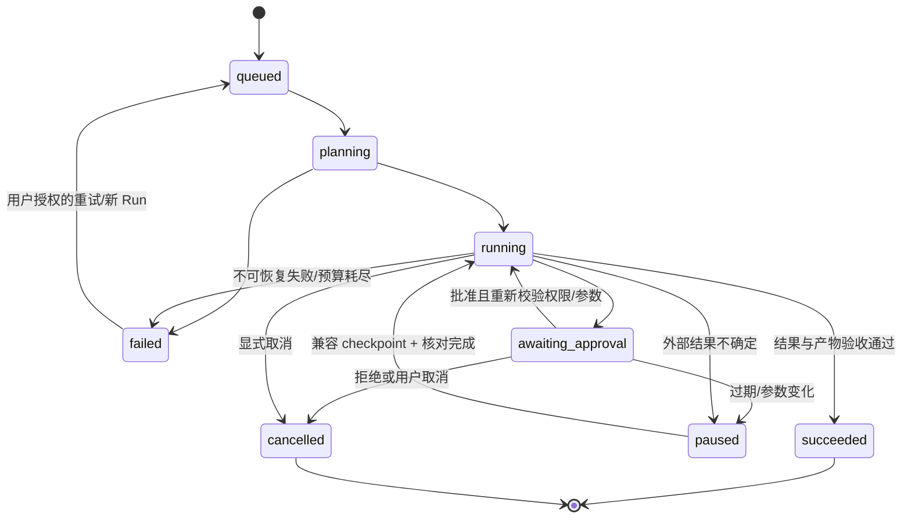

# 候选数据模型、迁移策略与单 Agent 最小扩展

日期：2026-11-06。配套 [源码审查](phase-0-system-audit.md)、[API 目录](target-api-catalog.md)。

**本文件是目标设计，不是生产迁移记录。** 用户已确认 PostgreSQL + 本地登录预留 OIDC/SSO；未选择 pgvector 或授权生产切换。当前代码默认 JSON，另有显式 SQL 认证入口。本地身份/会话/改密/成员库授权、001/002 与事务 dry-run 已落地，实际表/文件/验证范围见 [身份与授权交付](local-auth-access.md)；以下目标模型仍包含未实现的部门、OIDC、索引与 Agent 实体，不能整体视为已完成。

## 1. 现有数据与缺口

真实当前模型见 `server/types.ts`、`server/jobs/queue.ts`、`server/services/files.ts`：

| 当前对象 | 实际保存方式 | 不能推断出的能力 |
| --- | --- | --- |
| `Db.bases` / `documents` | JSON 数组，category 名称兼容与可选 baseId；文档含 chunks/versions | 无 SQL 外键、资源 ACL 或真实索引 |
| `DocumentVersion` | version 标签、字符串 chunks、兼容 id/chunkIds、原件 ID | 无页坐标/解析 profile/向量代际 |
| `Db.files` | 原件元数据，内容位于 `DATA_DIR/files/<sha256>` | 无对象存储、病毒隔离、清理保留期或后端访问授权 |
| `Db.tasks` | 文档任务；部分旧任务无 job；新 job 有输入、lease、checkpoint、events | 无多进程 SQL claim、真实复杂解析或 Agent 执行 |
| conversations/messages | 同一 JSON 内嵌消息、反馈、规则 trace/固定 sources | 无可信 owner、真实模型 generation 或 SSE |
| members/rules | 姓名/邮箱/部门/角色与固定矩阵 | 成员不是登录用户，矩阵不能直接当作真实授权策略 |
| settings | 工作空间、tenant 字符串、模型名称/开关、文本切分参数 | tenant 不是可信安全上下文，模型名称不是已配置 provider |
| evaluations/auditLogs/idempotency | 规则评测、部分审计、重放结果 | 无真实质量基线、可信 actor、完整审计或用户隔离 |

## 2. 关系模型公共约定

1. 业务 ID 使用 text 保留现有 b1/d1、createId 与兼容版本 ID；不强迫全部重编 UUID。新用户身份 ID 使用 UUID。tenant ID 来自 session/membership，不能来自普通请求 body。
2. 下表“C”表示通用列 `tenant_id text NOT NULL`、`created_at timestamptz`、`updated_at timestamptz`、`revision bigint NOT NULL DEFAULT 1 CHECK(revision>0)`。新写入必须有完整时间；旧数据只有日期时允许导入为 null 时间并保留 `legacy_date date`，不得伪造精确历史时刻。
3. 业务表主键默认 `(tenant_id,id)`，FK 带 tenant，避免跨租户关联。可读名称不能作为 FK。用户全局表除外；权限使用成员与资源关系。
4. JSONB 只保存版本化 Schema 的配置/事件/执行快照，核心关系与可检索状态不能全部塞进一个 SQL JSON 列。所有 status 用 CHECK 或枚举约束，迁移采用可扩展 CHECK 避免任意增删数据库 enum 的运维负担。
5. 删除采用明确 tombstone/retention；FK 默认 RESTRICT，不一刀切 CASCADE 删除文件/审计/任务。是否允许物理清理与保留期需组织确认；当前不执行。
6. 索引列顺序优先 tenant，再是过滤条件、排序键/id；实际查询计划和性能基线再决定增减。下面是候选索引，不是已经创建的索引。

### 2.0 首版授权政策（本方案的实现选择）

首版只实现**成员对知识库的显式 grant**，不实现资源级角色 grant、部门继承、deny 或通配符。role.permissions 是可用能力的上限，实际库权限为角色能力与该成员 grant 的交集，再检查 tenant/membership/resource 状态。write/publish/manage 不隐式生成 read；创建库需要 create/manage 能力，并在同一事务给创建者授予其角色允许的库权限。

WA 可以管理本租户成员和库 grants，但没有自动读取文档内容的豁免；需要内容访问时必须显式授予 read 并留审计。普通库管理者 KM 只能管理自己有 manage grant 的库，不能授出高于受授者角色上限的权限。旧“全体员工/部门”文案只作元数据，不自动转成 grant。API/DB 均采用 memberId；以后若增加角色 grant，需另行扩展 Schema、迁移及权限合并测试，不在首版偷偷启用。

普通 KR 读取已发布版本；KW 可读取/编辑草稿和版本。检索、模型上下文与引用始终只使用 published version/generation，且每次复验当前 read 权限。会话与 Agent 产物不能绕过其来源文档的当前访问政策。

### 2.1 迁移与回滚代号

每个实体行都标明适用批次/回滚，公共策略同样适用于该行，不代表略去单表影响：

- **M1 / R1（P2 核心）**：在独立目标库建立核心表与 tenant 外键，导入稳定 ID/关系/版本/任务/原件元数据，逐表核对。R1：切换前可弃置空试验库；切换后若已有新写入，必须先停写、备份并导出兼容增量，再决定回切，不能直接用旧 JSON 覆盖。默认向前修复，不自动 DROP 业务表。
- **M2 / R2（P3 索引/模型）**：加新表与 nullable 关联，再离线构建新代际；校验通过只标 ready，具备 KP 的显式 publish 才短事务切换公开指针。R2：由授权发布者切回上一可用代际/profile；保留原件、版本和历史向量，不能把回滚应用等同删文档/删索引。
- **M3 / R3（P4 Agent）**：增加 Run/Step/审批/工具记录，复用现有 jobs 与文件；开始只启用三个受控场景。R3：停止新 Run，停用新工具，保留 checkpoint/审计/产物；已经执行的外部副作用需核对/补偿，不能靠删表撤销。

### 2.2 P2 身份、知识与可靠任务

以下为完整目标模型；001-core/002-auth 与此表并非一一完成关系：核心实体、版本/分块/任务/消息、本地 users/identities/sessions/memberships/grants 已实现，旧成员仍单列 legacy_members；部门、SSO 及部分目标列尚未实现，具体以身份交付和 SQL 源码为准。SQL 只在临时验证环境创建后清理，没有生产迁移。`PK`、`UQ`、`FK`、`IX` 分别为主键、唯一约束、外键与索引。C 的 tenant 外键均引用 tenants.id。

| 表名 | 字段与类型（含 C 时继承公共列） | PK/FK/UQ | 索引 | 状态与生命周期 | 迁移/回滚 |
| --- | --- | --- | --- | --- | --- |
| `tenants` | id text，name text，status text，authz_version bigint，created_at/updated_at timestamptz | PK id；authz_version>0 | IX status,id | active/suspended；暂停不删除数据 | M1/R1；由现有工作空间单一 tenant 映射，不信任随意输入 |
| `users` | id uuid，email_normalized text，display_name text，status text，created_at/updated_at timestamptz | PK id；UQ email_normalized；非空且规范化 | IX status,id | invited/active/disabled；禁用撤销 session | M1/R1；旧 Member 不直接成为已验证用户 |
| `auth_identities` | id uuid，user_id uuid，provider text，provider_subject text，password_hash text nullable，created_at timestamptz | PK id；FK user；UQ(provider,provider_subject)；本地密码与 OIDC 字段受 CHECK | IX user_id | 本地账户或已选 OIDC 身份；不存明文密码 | M1/R1；只实现选定分支，密码派生/参数验证后确定 |
| `auth_sessions` | id uuid，user_id uuid，tenant_id text，token_hash text，expires_at/last_seen_at/revoked_at timestamptz | PK id；FK users/tenants；UQ token_hash | IX(user_id,expires_at)、expires_at | 有效/过期/已撤销由时间判断；登出撤销 | M1/R1；不导入浏览器演示登录状态；回切需重新登录 |
| `roles` | C，id text，name text，permissions jsonb | PK(tenant,id)；UQ(tenant,name)；permissions 为明确枚举集合 | IX tenant,name | 管理员/编辑者/成员为初始角色，不等于全库公开 | M1/R1；旧角色标签映射为明确权限，不把矩阵通配授予 |
| `memberships` | C，id text，user_id uuid，role_id text，department_id text nullable，status text | PK(tenant,id)；FK user/同租户 role/department；UQ(tenant,user) | IX(tenant,role_id)、(tenant,status) | invited/active/disabled；角色变更提升 authz_version | M1/R1；保留 legacy member ID；同名不自动绑定 |
| `departments` | C，id text，name text，parent_id text nullable，status text | PK(tenant,id)；FK 同租户 parent；UQ(tenant,parent_id,name)，根节点名称单独唯一 | IX(tenant,parent_id) | active/archived；禁止环；停用不移除历史 actor | M1/R1；当前平铺枚举可导入根节点，未知名称列冲突 |
| `knowledge_bases` | C，id/name/description/color text，owner_membership_id text nullable，status text | PK(tenant,id)；FK owner member；UQ(tenant,name_normalized)，另存 name_normalized text | IX(tenant,status,updated_at,id) | active/archived/deleted；非空删除受政策与任务阻止 | M1/R1；旧 category 必须唯一映射，保留 API name |
| `knowledge_grants` | tenant_id/base_id/membership_id text NOT NULL，permissions jsonb，revision bigint | PK(tenant,base_id,membership_id)；同租户 FK base/member；permissions 为明确枚举子集 | IX(tenant,membership_id,base_id) | 首版仅成员显式 read/write/publish/manage；与角色上限求交；变更提升 authz_version | M1/R1；静态四行规则不能不经映射变成 grants |
| `file_artifacts` | C，id text，uploader_membership_id text nullable（仅旧记录可空），name/media_type/sha256/storage_key/purpose text，size_bytes bigint，state text，retained_until timestamptz nullable | PK(tenant,id)；FK uploader member；UQ(tenant,uploader_membership_id,sha256,name,purpose)；新上传 id 按主体命名空间生成；size>0；sha256 64 hex；storage_key 只能服务端生成 | IX(tenant,state,created_at)、(tenant,sha256)、(tenant,uploader_membership_id) | staged/linked/quarantined/deleted；purpose=input/output；暂存仅上传者可引用；共享 blob 的物理删需引用/保留期验证 | M1/R1；旧 uploader 未知时隔离待映射，复制并校验当前原件，缺失不能制造空文件 |
| `documents` | C，id/base_id/name/type/status text，draft_version_id/published_version_id/published_generation_id text nullable，source_artifact_id text nullable，metadata jsonb，legacy_date date nullable | PK(tenant,id)；FK base/artifact；草稿/发布 version 与 document 使用同属复合 FK，published generation 必须对应 published version；迁移最后加可延迟约束 | IX(tenant,base_id,status,updated_at,id)、(tenant,source_artifact_id) | draft/published/archived/deleted；草稿变更不改变对外发布指针；旧中文 API 状态由 Adapter 映射 | M1/R1；未有真实索引时 published_generation_id 保持 null |
| `document_versions` | C，id/document_id/version_label/content_sha256/parser_profile_id text，source_artifact_id text nullable，state text，legacy_date date nullable | PK(tenant,id)；FK document/artifact；UQ(tenant,document_id,version_label)、UQ(tenant,document_id,id)，供同文档复合 FK 引用 | IX(tenant,document_id,created_at,id) | staging/ready/failed/archived；版本内容不可原地覆盖，回滚创建新版本 | M1/R1；旧无 ID 版本用确定性 legacy 映射，重复标签阻止导入 |
| `chunks` | tenant_id/id/version_id text，ordinal int，content text，parent_id text nullable，locator jsonb，content_sha256 text | PK(tenant,id)；FK version；UQ(tenant,version_id,id) 支撑同版本 parent 复合 FK；UQ(tenant,version_id,ordinal)；ordinal≥0 | IX(tenant,version_id,ordinal)、parent_id（带 tenant） | 与版本同生命周期；locator 标 source page/offset，未知时为空而非编造页码 | M1/R1；旧字符串按顺序导入，已有重叠不拼接重切 |
| `processing_tasks` | C，id/document_id/version_id/kind/state text，profile_key text NOT NULL，attempt/max_attempts int，available_at/lease_until timestamptz，lease_token text nullable，input_ref/checkpoint jsonb，error_code text nullable | PK(tenant,id)；FK document/version；UQ 部分索引：同 tenant/version/kind/profile_key 的 queued/running/retry_wait 任务；文本 profile_key 为版本化配置键，避免 NULL 绕过唯一性 | IX(state,available_at,id)、(tenant,document_id,created_at) | queued/running/retry_wait/succeeded/failed/cancelled；租约 fencing 防旧结果提交；M3 可增加 run_id 与目标恰一 CHECK | M1/R1；旧无 job 记录标 legacy，不凭 stage 制造完成事件 |
| `task_events` | tenant_id/task_id text，sequence bigint，time timestamptz，type text，data jsonb | PK(tenant,task_id,sequence)；FK task；sequence>0 | IX(tenant,task_id,sequence) 已由 PK 支撑 | 追加有序事件；不含租约 token/密钥/全文；保留按政策 | M1/R1；旧无事件允许空，不补造历史 |
| `conversations` | C，id/owner_membership_id/title text，state text | PK(tenant,id)；FK owner member | IX(tenant,owner_membership_id,updated_at,id) | active/archived/deleted；只对授权主体显示 | M1/R1；旧 owner 未知时隔离待认领，不默认归当前管理员 |
| `messages` | C，id/conversation_id/role/content/state text，sequence bigint，generation_id text nullable，citations/retrieval_snapshot jsonb | PK(tenant,id)；FK conversation；UQ(tenant,conversation_id,sequence) | IX(tenant,conversation_id,sequence) | queued/streaming/completed/failed/cancelled；原始消息不可被再生成覆盖 | M1/R1；旧规则来源标 source_kind=demo，不改写为真实引用 |
| `message_feedback` | tenant_id/message_id/membership_id text，rating text nullable，comment text nullable，updated_at timestamptz | PK(tenant,message_id,membership_id)；FK message/member；rating up/down/null | IX(tenant,message_id) | 清除反馈为 null/删除该反馈记录，政策需一致 | M1/R1；旧无可信反馈者记录保留 legacy，不虚构用户 |
| `workspace_settings` | C，id text 固定 workspace，values jsonb，schema_version int | PK(tenant,id)；CHECK id='workspace' | tenant PK 足够 | revision 递增；设置不能改 tenant；无 API Key | M1/R1；保留旧配置字段，仅真实支持参数生效 |
| `audit_events` | tenant_id/id text，time timestamptz，actor_membership_id text nullable，actor_kind/action/target_type/target_id/outcome/code/request_id text，data jsonb | PK(tenant,id)；FK 可空 actor；禁止业务角色 UPDATE/DELETE | IX(tenant,time,id)、(tenant,target_type,target_id,time)、(tenant,actor_membership_id,time) | append-only；actor_kind=user/system/legacy_unverified；拒绝/失败也记录，脱敏 | M1/R1；旧伪权限链只留原始 legacy 内容，不升级可信级别 |
| `idempotency_records` | tenant_id/actor_key/key/fingerprint text，result jsonb，expires_at/created_at timestamptz | PK(tenant,actor_key,key)；指纹含方法/路由/规范化输入/前置条件 | IX expires_at | 已提交结果重放，冲突拒绝；TTL 清理属于明确维护任务 | M1/R1；旧 unconfigured-auth 不映射为任何真实用户的 key |

密码、session、管理员 bootstrap 与旧记录认领依赖身份选择。不能先给所有 Member 生成默认密码，再声称完成认证迁移。知识库默认可见范围也不能由“全体员工”文案直接转成所有租户公开。

### 2.3 P3 模型、索引与质量实体

| 表名 | 字段与类型 | PK/FK/UQ | 索引 | 状态与生命周期 | 迁移/回滚 |
| --- | --- | --- | --- | --- | --- |
| `model_configs` | C，id/name/purpose/provider/model/base_url/secret_ref/status text，options jsonb | PK(tenant,id)；purpose llm/embedding/rerank；UQ(tenant,name,purpose) | IX(tenant,purpose,status) | untested/ready/failed/disabled；秘密只存引用，读取 DTO 掩码 | M2/R2；现有字符串名称只导入 untested，不自动连网或扣费 |
| `retrieval_profiles` | C，id/logical_id/name text，profile_version int，embedding_config_id/rerank_config_id text nullable，chunking jsonb，top_k int，threshold numeric，weights jsonb，schema_version int | PK(tenant,id)；FK model configs；UQ(tenant,logical_id,profile_version)；profile_version>0 | IX(tenant,logical_id,profile_version)、(tenant,created_at,id) | draft/active/retired（state text）；每个 profile ID 的检索内容不可变，生命周期可更新 | M2/R2；固定旧参数不能当成已验证模型 profile |
| `index_generations` | C，id/document_id/version_id/profile_id/backend/state text，dimension int nullable，checksum/error_code text nullable，activated_at timestamptz nullable | PK(tenant,id)；FK version/profile/doc；UQ(tenant,version_id,profile_id)；验证版本属于文档 | IX(tenant,document_id,state,created_at) | building/ready/active/failed/retired；完整写入并校验后才切 active | M2/R2；旧 JSON 分块不生成假索引记录 |
| `index_entries` | tenant_id/id/generation_id/chunk_id text，lexical_content tsvector，vector_ref text nullable，embedding_sha256 text nullable | PK(tenant,id)；FK generation/chunk；UQ(tenant,generation_id,chunk_id) | lexical GIN 候选；(tenant,generation_id)；向量物理索引依选型与维度验证 | 与 generation 同生命周期；只有完整 generation 可被检索 | M2/R2；若选 pgvector，再用独立迁移加已验证 vector 列/索引；目前不宣称存在 |
| `generations` | C，id/conversation_id/user_message_id/assistant_message_id/model_config_id/profile_id/state text，lease/checkpoint jsonb，usage jsonb，error_code text nullable | PK(tenant,id)；FK conversation/messages/models/profile；UQ(tenant,user_message_id,attempt)，attempt int | IX(tenant,conversation_id,created_at)、(state,updated_at) | queued/running/succeeded/failed/cancelled；输出与消息事务关联 | M2/R2；旧预置答复不改写为模型 generation |
| `generation_events` | tenant_id/generation_id text，sequence bigint，time timestamptz，type text，data jsonb | PK(tenant,generation_id,sequence)；FK generation | PK 支撑重放 | 追加；文本 delta/引用/usage/终态；权限变更后订阅复验 | M2/R2；回退保留已保存消息与事件 |
| `evaluation_datasets` | C，id/name/source_artifact_id text，schema_version/sample_count int，sha256 text | PK(tenant,id)；FK artifact；UQ(tenant,sha256) | IX(tenant,name,created_at) | immutable/retired（state text）；样本含授权用户与 expected 来源/答案 | M2/R2；旧八题作为 legacy-rule 数据集，不冒充质量黄金集 |
| `evaluation_runs` | C，id/dataset_id/profile_id/model_config_id/state/metric_scheme text，metrics jsonb，started_at/finished_at timestamptz | PK(tenant,id)；FK dataset/profile/model nullable | IX(tenant,dataset_id,created_at)、(tenant,state) | queued/running/succeeded/failed/cancelled；metrics 终态后固化 | M2/R2；旧指标 metric_scheme=legacy-rule；不与真实基线混比 |
| `evaluation_results` | tenant_id/run_id/sample_id text，retrieval/answer/citation/permission/latency jsonb，error_code text nullable | PK(tenant,run_id,sample_id)；FK run | IX(tenant,run_id) | 逐样本保存结果/错误；不把调用失败剔除后报更高成功率 | M2/R2；保留旧结果，不重写历史评价 |

`retrieval_profiles` 采用一个 ID 对应一个不可变内容版本，logical_id/profile_version 表示同一逻辑策略的修订；公共 revision 只处理生命周期状态的并发更新。改变模型、维度或检索参数必须创建新的 profile ID，不能原地改变已经构建的索引语义。此为本方案的实现决策，尚未建立实际表。

### 2.4 P4 Agent 实体（最小运行时，不引入多 Agent）

| 表名 | 字段与类型 | PK/FK/UQ | 索引 | 状态与生命周期 | 迁移/回滚 |
| --- | --- | --- | --- | --- | --- |
| `agent_tasks` | C，id/owner_membership_id/title/instruction/state text，base_ids/attachment_ids/skill_refs jsonb | PK(tenant,id)；FK owner；JSON 引用在事务内逐个校验同租户、权限及存在性 | IX(tenant,owner_membership_id,updated_at,id) | draft/ready/archived；修改任务提升 revision，不改已开始 Run 快照 | M3/R3 |
| `agent_runs` | C，id/task_id/state/model_config_id text，task_snapshot/plan/budget/usage jsonb，started_at/finished_at timestamptz，error_code text nullable | PK(tenant,id)；FK task/model；UQ 部分索引：同 task 活跃 Run（首版限制一条） | IX(tenant,task_id,created_at)、(state,updated_at) | queued/planning/running/awaiting_approval/paused/succeeded/failed/cancelled | M3/R3；复用 processing_tasks 领取执行，新增 run_id 关联与目标恰一 CHECK |
| `agent_steps` | C，id/run_id/kind/state/name text，ordinal int，input/output_summary jsonb，attempt int | PK(tenant,id)；FK run；UQ(tenant,run_id,ordinal) | IX(tenant,run_id,ordinal) | pending/running/awaiting_approval/succeeded/failed/skipped/cancelled；串行步骤，首版不并行执行 | M3/R3 |
| `tool_calls` | C，id/run_id/step_id/tool_name/tool_version/arguments_hash/operation_key/state text，arguments/result_ref jsonb，error_code text nullable，started_at/finished_at timestamptz | PK(tenant,id)；FK run/step；UQ(tenant,operation_key)；参数与审批指纹一致 | IX(tenant,run_id,created_at)、(tenant,state) | prepared/awaiting_approval/running/succeeded/failed/unknown/cancelled；unknown 停待核对，不能自动重做副作用 | M3/R3 |
| `approvals` | C，id/tool_call_id/approver_membership_id/arguments_hash/state text，tool_version text，expires_at/decided_at timestamptz | PK(tenant,id)；FK call/member；UQ(tenant,tool_call_id,arguments_hash) | IX(tenant,approver_membership_id,state,expires_at) | pending/approved/rejected/expired/invalidated；参数/工具变更使旧批准失效 | M3/R3 |
| `run_checkpoints` | tenant_id/id/run_id text，sequence bigint，schema_version int，runtime_version text，state_snapshot jsonb，created_at timestamptz | PK(tenant,id)；FK run；UQ(tenant,run_id,sequence) | IX(tenant,run_id,sequence) | immutable；版本不兼容不能盲目恢复；不存隐藏推理，仅必要执行状态 | M3/R3 |
| `run_events` | tenant_id/run_id text，sequence bigint，time timestamptz，step_id text nullable，type text，data jsonb | PK(tenant,run_id,sequence)；FK run/step | PK 支撑增量事件 | 追加；公开 DTO 脱敏，不暴露密钥/原始工具凭据 | M3/R3 |
| `run_artifacts` | tenant_id/run_id/artifact_id text，purpose text，source_version_ids jsonb，created_at timestamptz | PK(tenant,run_id,artifact_id)；FK run/file_artifacts | IX(tenant,artifact_id) | 关联实际产物；权限撤销后按来源政策限制下载 | M3/R3；不创建第二套物理文件存储 |
| `mcp_servers` | C，id/name/endpoint/secret_ref/state text，allowed_tools/capabilities jsonb，config_version int | PK(tenant,id)；UQ(tenant,name) | IX(tenant,state) | disabled/verified/enabled；首版只启用明确选定服务器，不接受模型动态注册 | M3/R3；端点/传输/凭据方案需要确认与技术验证 |

Tool Registry 和 Skill Registry 首版使用受版本控制的 TS/JSON/Markdown 定义，由应用启动加载和校验，不额外搭数据库市场或在线任意脚本编辑器。Run 固化定义版本/hash；变更定义不影响正在执行的已批准参数，恢复前验证兼容性。

## 3. JSON → SQL 的安全迁移步骤

1. **只读预检（已实现 `scripts/check-data.ts`、`server/services/data-check.ts`）**：不调用会初始化/写入的 Store.load，直接读显式指定的停写副本 JSON；校验基础形状、重复 ID/规范化名字、版本标签、知识库关系、任务版本及原件存在/长度/hash。只输出固定问题码、数组位置、计数和输入摘要，不输出业务 ID/正文/名称。身份与资源规则映射仍标待处理，`migrationReady` 始终为 not_assessed，不等同 SQL dry-run。临时夹具/seed 示例已验证，未读取用户运行时数据；详见 [数据预检说明](data-preflight.md)。
2. **确定性映射**：保留已有 ID；缺失版本/分块 ID 按 tenant/doc/version/ordinal 生成稳定映射。存在多个同名库或重复版本时阻断，不取第一条覆盖。旧固定引用保留 source_kind=demo，不伪造文档 FK。
3. **原件核对**：拷贝原件与 JSON 到同一备份批次，逐个摘要验证；缺失文件不能用空文件或名称替代。孤立原件列清单，不自动清理；不跟随未知符号链接向工作区外遍历。
4. **dry-run（核心结构已实现）**：`scripts/migrate-data.ts` 在独立新 Schema 的同一事务中创建核心结构、导入、核对行数/关系/全文并回滚，已用真实 PostgreSQL 测试；身份/资源映射仍待建立，报告 cutoverReady=false。目标完整 dry-run 需在后续身份 Schema 落地后扩展，不修改运行配置。
5. **真实目标导入**：明确选型并批准切换后，停止旧 JSON 唯一写进程；记录备份摘要、迁移版本和映射表。新库事务提交、原件校验、只读 API 对比通过后才改连接配置。不要先做双写，再把双写失败隐藏。
6. **未知记录处理**：无法绑定 owner 的会话/任务隔离待认领；旧矩阵没有明确 base 映射时不授予访问；没有真实 job 的历史记录保留 legacy 状态，不制造 checkpoint/events。
7. **切换验收**：两用户/两租户隔离、编辑/发布/回滚、取消/恢复、原件下载、幂等重启、审计与页面数据核对。行数相同不足以通过，还要检查关联和授权语义。
8. **回滚演练**：切换前失败仅弃用试验目标；切换后已有写入先停写并导出新记录，避免丢新数据。新加数据不能被旧客户端理解时采用兼容读/向前修复，不自动降级或 DELETE 字段。

不在每次启动时自动迁移、不自动创建生产管理员、不自动导入演示 localStorage。迁移命令必须显式指定来源与独立目标，输出审查报告；真正 apply 与生产切换独立执行。

## 4. RAG 目标流水线与一致性

| 环节 | 增量方案 | 验证/权限要求 |
| --- | --- | --- |
| 解析 | 原件→隔离解析器→标准块/表格/页定位；TXT/MD 复用当前文本能力 | 超时、尺寸/页数/解压上限；坏文档可失败重试，不把文件签名当解析成功 |
| Chunking | 先用现有固定长度建立真实基线；语义/父子策略按 profile 逐项验证 | token/字符单位明确、重叠不重复累计；父子属于同版本，元数据保留定位 |
| Embedding | 只调用选定提供商；缓存按模型/维度/profile/content hash | 不跨用户绕过授权复用敏感结果；批次重试有幂等记录和成本上限 |
| Indexing | 构建完整 generation，核对计数/hash/维度后只标 ready；必须显式 publish 才切公开指针 | 编辑/重建只需 KW，切换必须 KP；旧发布版本在新构建/审批失败时继续可读，不自动升级 |
| Query Rewrite | 默认先不启用，评测证明收益后加单模型改写 | 原 query 保留；改写不能扩大 baseIds 或授权范围；注入文本不改变系统政策 |
| Retrieval | 后端将请求库集合与授权集合求交/按政策拒绝，限定 published + active generation | DB/向量过滤 + 结果复验；缓存 key 含 tenant/主体或 ACL 版本/profile；历史答案也复验 |
| 混合召回 | 真关键词索引与向量召回，使用明确融合策略 | 修正当前伪 BM25 df/非有限分值；参数与候选数可复现，不编造得分 |
| Rerank | 在授权候选内调用选定模型；记录真实耗时与成本 | 超时使用明确降级策略并回传 degraded，不能悄悄称重排完成 |
| Context | 限制 token、去重、保留来源定位与版本；工具结果/文档是非可信数据 | 注入不能产生新工具权限；缺证据时拒答/澄清；不按规则 kind 硬给答案 |
| Generation | 通过已验证模型配置，持久化 generation/message/events | 真实 streaming/cancel/错误终态；不要把 UI 打字动效当流式协议 |
| Citation | 从实际使用的 chunks 产生 document/version/chunk/locator 引用 | 当前授权、原件/版本存在、支持本段回答；无法定位不制造页码 |

权限属于可信服务端政策，不能靠模型“请勿泄露”或前端隐藏库。模型只选择已提供的授权工具/材料，不能决定可访问范围。

发布事务同时校验 KP、文档 revision、明确的 versionId/generationId、generation=ready、版本属于文档及 profile 可用，再原子更新 published_version_id/published_generation_id，将旧 generation 退休、新 generation 激活并追加发布审计。哪怕只是给当前发布版本重建索引，也必须显式发布，不能通过 KW 自动改变公开检索效果。新草稿不替换旧已发布内容；归档立即停止所有公开检索。P3 将现有 publish 的请求升级为 `{revision,versionId,generationId}`，前后端同批发布；旧缺目标请求明确拒绝，不静默选择最新草稿。当前原型接口未改，仍仅按已保存文本状态检查发布。

性能先按文档数、字符/token 数、向量维度、并发、缓存冷热和模型/profile 记录实际基线；当前随机 stage.ms 不参与基线。再约定 Recall@K、引用支持率、拒答与越权上限及 P50/P95 目标，未测前不给“企业级毫秒响应”数字。

## 5. 单 Agent 最小运行时

### 5.1 执行流程和状态

用户任务 → 输入/附件授权 → 单 Agent 计划 → 已注册工具选择 → Schema/权限校验 → 必要人工审批 → 执行 → 结果 Schema/文件检查 → checkpoint → 下一步或交付。

首版用现有持久任务队列领取一个 agent_run，单进程串行执行。SQL 方案选定后 claim/lease 使用事务与 fencing，才支持多 worker；不增加 Redis、Supervisor 或分布式工作流平台。Run 保存必要可恢复状态与可观察摘要，不保存或展示模型隐藏推理。

Run 预算有 maxSteps、总超时、模型 token/费用上限及单工具超时。用户断开事件流不自动取消；显式取消阻止后续步骤，已经提交的侧效标明实际结果。遇到外部请求已发送但无确认的情况，状态为 unknown/paused，先查远端 operation key/结果，不自动再写一次。

### 5.2 Tool Interface

每个工具定义必须包含 name/version、严格 inputSchema/outputSchema、requiredPermissions、sideEffect、timeoutMs、idempotency 策略、approvalPolicy、可重试错误枚举和结果核对方法。工具不能读取任意文件路径或继承开发代理的 OS/Git/MCP 权限。

首版候选工具（下面的文件路径与实现均为 NEW）：

| 工具 | 输入 Schema | 输出 Schema | 权限/副作用/审批 | 超时/幂等 | 错误与核对 |
| --- | --- | --- | --- | --- | --- |
| `knowledge.search` v1 | `{query:string,baseIds:string[],topK:int,profileId:string}`；query≤4,000，topK≤20 | `{hits:[{documentId,versionId,chunkId,content,locator,score}],traceId}` | KR；只读，不需侧效审批；后端先限制库集合 | 初始预算 15s（配置值、待实测）；同 Run/输入可缓存，绑定 authzVersion | FORBIDDEN、PROFILE_NOT_READY、SEARCH_TIMEOUT；命中再授权 |
| `knowledge.read_chunks` v1 | `{documentId,versionId,chunkIds:string[]}`，有数量上限 | `{chunks:[{id,content,locator}],sourceArtifactId?}` | KR；只读；历史版本也复验 | 初始预算 10s；固定版本读取幂等 | VERSION_NOT_FOUND、FORBIDDEN、SOURCE_UNAVAILABLE；摘要/位置检查 |
| `document.extract` v1 | `{documentIds:string[],fields:[{name,type,required}],format:'json'\|'csv'}` | `{rows:object[],sources:VersionCitation[],warnings:string[]}`，字段类型必须验证 | KR；读+模型计算；不能因工具名就允许访问未选文档 | 初始预算 60s；按输入版本/模型/Schema 指纹缓存；模型费用受 Run 预算 | MODEL_TIMEOUT、SCHEMA_MISMATCH、NO_EVIDENCE；失败不捏造字段 |
| `artifact.write` v1 | `{name,format:'md'\|'json'\|'csv',content,sourceVersionIds:string[]}`；内容长度限制 | `{artifactId,name,mediaType,size,sha256}` | Run 产物写权限；只写自己受控目录，不能用户提供任意路径；常规 Run 产物不需另一次外部审批 | 初始预算 10s；operation key 唯一、摘要复用；校验文件可读 | ARTIFACT_TOO_LARGE、STORAGE_FAILED、INTEGRITY_ERROR；JSON 可解析/CSV 安全转义 |
| `knowledge.propose_action` v1 | `{targetDocumentId,expectedRevision,action:'archive'\|'change_metadata',changes?:{name:string}}`；首版 metadata 只允许 name | `{proposalId,argumentsHash,requiresApproval:true}` | 归档需 KP、改名需 KW；只提出计划不执行写入 | 初始预算 5s；同目标/revision/参数确定性 | VERSION_CONFLICT、FORBIDDEN；与实际写工具严格分开 |
| `knowledge.apply_action` v1 | `{proposalId,approvalId}`；不接受 approved=true | `{operationId,targetId,newRevision,status}` | 真实 KW/KP、指定审批、最新 revision；有副作用必须批准与审计 | 初始预算 15s；工具 operation key 与业务 mutation 同事务 | APPROVAL_EXPIRED、ARGUMENTS_CHANGED、VERSION_CONFLICT；核对目标新 revision |
| `mcp.<server>.<tool>` | 发现的 input Schema 通过本地白名单包装，不原样信任 | output Schema 包装并限制体积/敏感字段 | MCP 凭据代表受限账号；未知侧效默认需审批；模型不能注册 server | 超时按已验证服务配置；远端无幂等/查询能力的写操作不得自动恢复 | MCP_UNAVAILABLE、TOOL_SCHEMA_CHANGED、EXTERNAL_RESULT_UNKNOWN；按服务器明确核对协议 |

上述超时只是可配置的初始保护预算，不是现有性能测量或 SLA。`document.extract` 的模型输出必须做业务 Schema 校验，不能用“模型说提取完成”当作成功。`artifact.write` 复用现有原件存储和摘要检查，CSV 要防公式注入，不拼接 shell 导出文件。

### 5.3 Skill 与 MCP

Skill 是受审查的任务模板、所需工具列表、输入/输出 Schema、版本与验收规则，可提供 Markdown 说明；不等同无限制执行脚本。Skill 加载仅使用已配置可信目录，禁止路径穿越或从知识文档临时下载并执行“新 Skill”。

MCP Client 首版只连接用户选定的一个服务器和白名单工具；依当前官方 SDK/传输规范做技术验证后才实现。发现能力与执行授权分离，工具 Schema/版本/侧效性质变化使旧审批失效。服务端 endpoint/凭据均由管理员配置，防 SSRF 与凭据跨租户泄露；不把开发环境现成插件连接自动赋给产品用户。

### 5.4 人工审批、Checkpoint 与审计

- 审批者由服务端从当前活跃成员中选出：必须有 `tool.approve` 能力及该动作的资源权限；模型不能指定任意用户充当审批者。站内首批低风险工具（归档、修改文档名称）允许具备上述权限的发起人在控制台明确自批；任务提交本身不算审批，也不能自动批准。涉及 grants/密级/部门/租户/删除的写入不列入该工具白名单。
- 外部 MCP 写工具首版默认 `different_member` 策略，审批者必须不同于发起人；只读 MCP 不因名称带 MCP 就自动要求审批，未知副作用工具默认禁用或按有副作用处理。没有合格审批者时以 `NO_ELIGIBLE_APPROVER` 暂停，不降低政策。审批默认有效 10 分钟（可配置保护值，不是用户已指定的 SLA）；启用外部写工具时连同实际组织审批政策一起确认。
- 审批绑定 tenant、run、tool call、工具版本、规范化参数 hash、目标资源 revision、审批者、过期时间。批准后到实际执行前重新校验权限和状态；撤权/参数变更不能沿用旧批准。
- Checkpoint 保存任务快照、工具定义版本、已完成 step/operation key、产物 ID、可恢复状态版本及必要结果引用。先保存 intent，再调用工具，再保存已核对结果；不承诺任意外部系统 exactly-once。
- 工具执行日志记录 request/run/step/call/approval IDs、结果码与时长、用量摘要，脱敏参数/结果；API Key、session token、模型系统指令和业务全文不进入普通审计。
- 侧效失败分为明确未执行、明确已执行、不确定三类；只有明确未执行且政策允许时自动重试。不确定时暂停核对；不可逆侧效没有通用回滚，只能事先审批与事后补偿。
- 文件产物必须实际存在、大小/hash 一致且可解析；最终答复附可访问产物链接与来源，不能只给一个未创建的文件名。

这三项政策（显式发布、首版仅成员 grants、分级审批与自批规则）是独立实施复核后给出的具体设计选择，不是用户已经口头选定的组织政策；落地前若用户有不同要求应调整，但不需要为文档继续保持多套互相矛盾的默认行为。

### 5.5 三个端到端场景与通过条件

| 场景 | 最小执行链 | 真实交付与验收 |
| --- | --- | --- |
| 多知识库调研报告 | 选定授权库→检索→读取版本分块→整理比较→验证引用→写 Markdown 报告 | 实际文件可下载、摘要匹配；每个引用指向授权版本/块；无证据部分明确列缺口；不杜撰来源 |
| 指定文档结构化提取 | 校验文档/版本权限→按字段 Schema 提取→类型/必填校验→导出 JSON/CSV | 文件可解析；行/字段与来源对应；未找到字段返回 null/错误而非编造；CSV 防公式；重复恢复不重复产物 |
| 知识分析后授权执行 | 检索/分析→产生含目标 revision 的计划→展示参数/影响→指定人审批→重新鉴权→执行受控文档操作→核对 | 未审批/拒绝/过期不写；批准后仅执行原参数；重复回调不重复侧效；审计与新资源状态一致 |

首版第三场景使用站内文档归档/元数据操作，验证审批后再接明确选定的外部 MCP 写工具。不能为了“看起来像 Agent”添加多代理对话、虚假步骤动画或只返回一个计划而不交付结果。

## 6. 部署与安全验收边界

当前确认的环境变量为 PORT、DATA_DIR、CORS_ORIGINS，开发/测试还有 ZHIXU_API_TARGET、PLAYWRIGHT_CHROMIUM_EXECUTABLE；当前没有 DATABASE_URL、模型 secret 或 SSO 配置读取实现。未来 `.env.example` 只记录名称/用途/示例，不提交真实值。

选型后 Docker/Compose 才定义 app、数据库、必要解析服务和持久卷；迁移作为显式独立步骤，readiness 验证依赖后再接流量。日志、审计、原件、数据库分别设访问与备份策略；健康端点不暴露连接串/密钥。CI 在临时环境跑类型、测试、构建、迁移 dry-run 与冒烟，不自动触发生产发布。

尚待真实验证：越权与缓存泄露、Prompt Injection、恶意文件/解压炸弹、Markdown/SVG/XSS、SSRF/重定向/DNS 变化、Secret 回显、并发审批与侧效、跨版本恢复、原件清理及备份恢复。静态设计、42 项现有测试或一个绿色 build 都不能代替这些验收。
